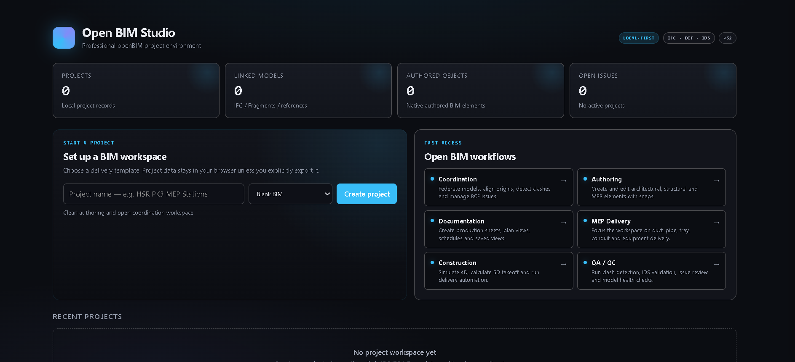

<p align="center">
  
</p>

<h1 align="center">openBIMstudio</h1>

**A web-native, open-source BIM authoring platform focused on professional modeling workflows and reliable IFC interoperability.**

openBIMstudio brings building information modeling into the browser. It is designed for architects, engineers, and developers seeking a lightweight, collaborative, open platform for creating and coordinating building models.

> **Status:** Early-stage / Active Development. The core authoring engine, parametric families, and IFC export are functional. Development is continuing against the capability gaps documented in the project roadmap.

---

## Key Features

- **Parametric Modeling:** Families with formulas, constraints, nested families, arrays, and type catalogs.
- **Architectural Tools:** Walls, slabs, roofs, stairs, railings, curtain walls, rooms, areas, and hosted elements.
- **Efficient Authoring Workflow:** Command center, command palette (Ctrl+P), align and distribute, match properties, and phasing.
- **Interoperability:** Export to IFC4 and IFC2X3 with stable GlobalIds, designed to support model exchange and round-tripping.
- **Modern Interface:** Walkthrough minimap, notifications, and resilient error handling.
- **Modular Architecture:** A boot system that loads modules safely.

For a detailed capability matrix, see [docs/CRITICAL_GAPS_CLOSURE.md](./docs/CRITICAL_GAPS_CLOSURE.md).

---

## Getting Started

**Prerequisites:** Node.js v18+ and npm.

```bash
git clone https://github.com/amdghedy/openBIMstudio.git
cd openBIMstudio
npm install
npm run typecheck
npm run dev
```

The entry point (`main.ts`) already imports `./critical-gaps-boot`; no extra wiring is required.

### Quick UI Tour

- **Command Center:** Opens on first load, or click **RC** in the bottom-left.
- **Command Palette:** Press Ctrl+P (Cmd+P on macOS) to search for tools.
- **Bottom Toolbar:** Drafting, hosts, solving, generators, visibility, and panels.

See [docs/INSTALL_AND_UX.md](./docs/INSTALL_AND_UX.md) for the full interface guide.

---

## Roadmap

- [Capability Matrix and Improvement Plan](./docs/CRITICAL_GAPS_CLOSURE.md)
- [Documentation and Installation Guide](./docs/INSTALL_AND_UX.md)

---

## Contributing

Read [CONTRIBUTING.md](./CONTRIBUTING.md). Pick a task from `docs/`, then open an issue or draft pull request to discuss it.

Please follow the project's [Contributor Code of Conduct](./CODE_OF_CONDUCT.md).

---

## License

MIT - see [LICENSE](./LICENSE).
