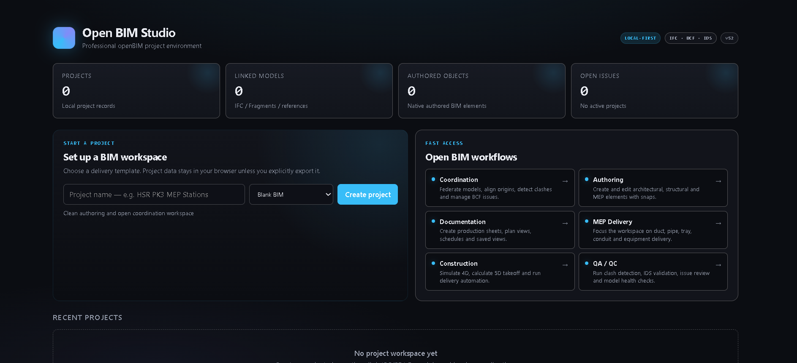

<p align="center">
  
</p>

<div align="center">

# OpenBIMStudio

### The open, local-first BIM workspace that runs in your browser

[](package.json)
[](LICENSE)
[](#-interoperability)
[](#)
[](https://github.com/amdghedy/openBIMstudio/actions/workflows/unit-tests.yml)
[](https://github.com/amdghedy/openBIMstudio/actions/workflows/native-bim-validation.yml)

**Local-first · Zero install · Open standards · IFC · BCF · IDS · PDF · CAD · AI-ready**

[Quick start](#quick-start) · [Why OpenBIMStudio](#-why-openbimstudio) · [What you can do](#-what-you-can-do) · [All tools & commands](#tools--commands) · [Interoperability](#-interoperability) · [Documentation](#-documentation)

<p align="center">
  <a href="https://www.buildingsmart.org/"></a>
  <a href="https://thatopen.com/"></a>
  <a href="https://threejs.org/"></a>
</p>
<p align="center">
  
  
  
  
  
  
</p>

</div>

---

## Repository snapshot

OpenBIMStudio is a browser-native BIM workspace for architecture, engineering, and coordination teams building around open standards, local-first workflows, and interoperable project delivery.

- Language mix: JavaScript 75.6% · TypeScript 24.1% · Other 0.3%
- Model: browser-first, local-first BIM application with optional server-backed AI/collaboration services
- Platform: React + Vite + Three.js + web-ifc / Fragments + MUI + WASM tooling
- Use cases: authoring, coordination, clash detection, documentation, validation, and issue exchange

This repository is designed to reduce the fragmentation of BIM tooling while keeping project data portable, inspectable, and vendor-independent.

---

## What is OpenBIMStudio?

OpenBIMStudio is a **browser-based, local-first BIM workspace** for architecture, engineering, and construction. It combines model authoring, multi-model federation, clash detection, BCF issue exchange, sheet production, and validation around open standards and a self-hosted local workflow.

One install (none, actually — it's your browser). One license (MIT — yours). Your model data stays on your machine by default.

> **Latest (v0.74.0):** cursor-accurate wheel zoom with a guaranteed orientation invariant (zoom never rotates the camera), full Content-Security-Policy with a self-hosted Fragments worker, and a wider set of modeling and documentation improvements.
>
> **Modeling (v0.73.0):** justification-aware wall & MEP modeling, magnetic snapping with persistent relationships, dependent-geometry updates in a single undo step, dynamic per-tool property panels, and stronger family/parametric workflows.

| For you if you… | OpenBIMStudio helps by… |
|-----------------|-------------------------|
| Need a free / open alternative for BIM | Full authoring + coordination workspace, MIT license, IFC-native |
| Coordinate multi-discipline models | Federation, worker-based clash detection, BCF issues, Copy/Monitor |
| Produce plans and sheets | Views, auto-dimension chains, tags, sheets with title blocks, PDF export |
| Validate deliverables | IDS requirements, native model QA, rule packs, model health diagnostics |
| Prefer open data | IFC, BCF, IDS, DXF, CSV, PDF — no proprietary lock-in, ever |

> **Note:** The platform is actively developed and tool maturity varies. Every capability below exists in the codebase today; check the [Master Tool Catalogue](documentation/MASTER_TOOL_CATALOG.md) for the current status and verification boundaries.

---

## 🚀 Why OpenBIMStudio

|  |  |
|---|---|
| 💰 **Free, forever** | MIT license. No seats, no subscriptions, no paywalled features. An integrated BIM workflow built around open standards. |
| 🌐 **Zero install** | The whole platform runs in the browser tab you already have open. Clone it for local use — no drivers, no licensing daemons, no installers. |
| 🔐 **Local-first & private** | Models stay on your machine by default. Cloud AI and collaboration are **opt-in and self-configured** — bring your own keys, point at your own server. |
| 🏗️ **Authoring to delivery in one app** | Walls to rebar, clash to BCF, views to sheets to PDF, quantities to cost, phasing to 4D. No stitching together five tools. |
| 🔓 **Open standards, no lock-in** | IFC 2x3/4, BCF, IDS, DXF, CSV, PDF. Your data is never hostage to a vendor. |
| 🤖 **Automate & extend** | Event-driven automation rules, an AI assistant (bring your own provider key), a plugin SDK with capability gating, and a sample plugin marketplace. |
| ✅ **Evidence-based engineering** | 50+ automated test suites run in CI, a public per-tool maturity catalogue, and documented known limitations. |
| 🧠 **Modern modeling engine** | Justification lines, magnetic snapping, constraint solving, parametric families with formulas, and deep authoring workflows. |

---

## Quick start

### Option A — Run locally (recommended)

```bash
# Requirements: Node.js 18+
git clone https://github.com/amdghedy/openBIMstudio.git
cd openBIMstudio
npm install
npm run dev
```

Open the URL shown in the terminal (usually **http://localhost:3000**).

### Option B — Production build

```bash
npm run build
npm run preview
```

### Deploy to Cloudflare Workers (with visit counter)

Pushes to `main` deploy automatically through the `deploy.yml` GitHub Action (`wrangler deploy`). The worker in `worker/index.ts` serves `dist/` and exposes the cumulative visit counter shown in the Project Center status bar (`POST/GET /api/visits`), backed by a SQLite Durable Object created automatically on deploy.

To deploy manually instead:

```bash
npm run deploy
```

### First 2 minutes in the app

1. The **BIM Command Center** opens (or click the blue **RC** button bottom-left).
2. Use **Import** to load an IFC model, or start modeling with **Wall / Door / Room**.
3. Press **Ctrl+P** to search any command (e.g. `Clash`, `Sheet`, `Schedule`).
4. Select elements → inspect **Properties** → try **Hide / Isolate**.

---

## 🎯 What you can do

### View & navigate
- 3D viewport (perspective & orthographic)
- Orbit, pan, zoom, fit, focus on selection
- **ViewCube** navigation (faces, edges, corners, Home menu, 90° orbit steps)
- Section planes & section boxes
- Hide / isolate / category visibility
- Measure, temporary dimensions, snapping
- Saved views, model tree, properties panel
- CAD & PDF underlays, point cloud viewing

### Model (architecture)
- Walls (including layered / compound), floors, roofs, ceilings
- Doors & windows (host-aware openings)
- Levels, grids (with bubbles), rooms & areas
- Stairs (straight, L, U, winder, spiral), railings, ramps
- Curtain walls, materials, reference planes, work planes
- Groups, design options, phases
- Parametric families (formulas, constraints, nested, arrays)
- In-place massing, wall sweeps, model curves

### Model (structure & MEP)
- Beams, braces, trusses, footings, foundations
- **Rebar** modeling
- Ducts, pipes, cable trays, conduits — with pressure & connectivity checks
- Routing, fittings (elbow geometry), fabrication parts
- P&ID-related workflows
- Analytical / structural model export paths, structural loads & connections

### Site & terrain
- Toposurfaces & site topology
- Building pads, property lines, site components

### Analyze
- Energy analysis paths
- Daylighting studies
- Sun settings & orientation

### Coordinate
- Load and align **multiple models** (federation)
- Clash detection (several methods, worker-based)
- Clash scenarios, grouping, status tracking
- **BCF** import/export for issues
- Copy / Monitor relationships
- Worksets & linked-model management

### Document
- Plans, sections, elevations, RCPs, details, plan regions
- Dimensions (linear, aligned, angular, radial, spot…) and **auto dimension chains**
- Tags (elements, rooms, materials), keynotes
- Sheets, viewports, title blocks, revisions, matchlines
- View templates, view filters & graphic overrides, filled regions, detail components, hatch patterns
- **PDF** export · CAD import/export paths · PDF underlay

### Quantify & plan
- Schedules and quantity take-off
- Cost items mapped from quantities (5D)
- CSV export
- 4D timeline / phasing simulation

### Check quality
- **IDS** information requirements
- Native BIM validation (IDs, hosts, geometry, sheets…)
- Rule packs (accessibility, fire, QA, structural review)
- Model health diagnostics

### Automate & extend
- Automation rules on model events
- AI assistant (optional providers — your keys, your choice)
- Plugin SDK with capability gating + plugin marketplace
- Sample plugins included: element counter, CSV take-off, clash rule pack, family-from-CSV
- Optional collaboration server (presence, worksharing concepts) — auth & hardening built in

---

## Tools & commands

Use the **ribbon**, **bottom toolbar**, **Command Center (RC)**, or **Ctrl+P** command palette.

### Project & files

| Command | What it does |
|---------|----------------|
| New / Open Project | Create or open a project |
| Project Browser | Browse projects and data |
| Project Information | Project metadata |
| Import / Export | Load or write supported files (IFC, DXF, and more) |
| Manage Links | Linked models, reload, transforms |
| Federation | Multi-model coordination workspace |
| Save View | Store camera / view state |

### Viewport

| Command | What it does |
|---------|----------------|
| Select / Multi-select / Box Select | Select elements |
| Orbit / Pan / Zoom / Fit / Focus | Navigate |
| Section / Section Box | Cut through the model |
| Hide / Isolate / Reset Visibility | Control what you see |
| Category Visibility | Show/hide by category |
| Measure / Temp Dimensions | Measure distances |
| Snapping / Transform Gizmo | Precise placement and edits |
| LOD Controls | Level of detail |
| Model Health | Diagnostics |

### Create & modify

| Command | What it does |
|---------|----------------|
| Wall / Floor / Roof / Ceiling | Building elements |
| Door / Window | Hosted openings |
| Levels / Grids | Datum references |
| Rooms / Areas | Spatial elements |
| Stairs / Railings / Ramps / Curtain Wall | Vertical circulation & facades |
| Structural Members / Rebar | Beams, braces, foundations, reinforcement |
| Ducts / Pipes / Trays / Conduits | MEP runs with fittings |
| Toposurface / Building Pad / Property Line | Site & terrain |
| Materials / Shared Parameters / Type Catalog | Data & appearance |
| Family Browser / Parametric Editor | Families & formulas |
| Move / Copy / Rotate / Mirror / Array | Transforms |
| Align / Distribute / Match Properties | Coordination edits |
| Paint / Group / Create Similar | Appearance & reuse |
| Copy / Monitor | Track linked elements |
| Phases / Design Options | Time & alternatives |

### Drawings & sheets

| Command | What it does |
|---------|----------------|
| Plan / Section / Elevation / RCP | Create views |
| Dimensions & Tags / Auto Dimensions | Annotate |
| Sheets & Viewports / Matchlines | Layout drawings |
| Title Blocks / Revisions / Keynotes | Issue control |
| View Templates / View Filters | Apply graphic standards |
| Filled Regions / Detail Components / Hatches | 2D detailing |
| Export PDF | Issue sheets |

### Coordination, QA & output

| Command | What it does |
|---------|----------------|
| Clash Detection | Find interferences |
| Clash Scenarios | Save rules & reviews |
| Issues / BCF | Track and exchange issues |
| IDS / Standards | Check information requirements |
| Validate Model | Native QA checks |
| Schedules / QTO / Cost | Quantities and estimates |
| 4D Timeline | Construction simulation |
| Energy / Daylighting / Sun Settings | Analysis paths |
| Automation Rules / AI Assistant | Automate repetitive work |

### Keyboard shortcuts (common)

| Shortcut | Action |
|----------|--------|
| **Ctrl+P** | Command palette |
| **Ctrl+Shift+R** | BIM Command Center |
| **Esc** | Cancel / clear tool |
| **Delete** | Delete selection |
| **Ctrl+Z / Ctrl+Y** | Undo / Redo (when history is active) |

### CAD Editor (DWG/DXF) — Modify tools

The standalone CAD Editor ribbon has a full **Modify** group with AutoCAD-grade transform tools. Select objects first (noun–verb), then run the command — or start the command and pick objects, then press **Enter / right-click** to finish the selection stage. Every transform shows a live yellow dashed ghost preview, supports osnap / ortho, numeric entry typed into the command line, and a single Undo step (Ctrl+Z).

**Multi-document workspace.** The editor opens any number of DWG/DXF files at once, one drawing per file tab (native-CAD-style tab strip with unsaved-changes dots, middle-click close, right-click tab menu with Save / Save All / Close Others / Close All, and `Ctrl+Tab` / `Ctrl+Shift+Tab` to cycle drawings). Drawings interact: `COPYCLIP` (Ctrl+C) places selected objects on a shared cross-drawing clipboard, `PASTECLIP` (Ctrl+V) drops them into another drawing at the view center with a cascade offset, and `PASTEORIG` (Ctrl+Shift+V) pastes at the original source coordinates — so plans, details, and legends can be assembled across files without any export/import step.

| Command | Alias | What it does |
|---------|-------|--------------|
| MOVE | `M` | Move selected objects: base point → second point (or displacement) |
| COPY | `CO` | Copy objects; keep clicking to place multiple copies, Enter to finish |
| ROTATE | `RO` | Rotate around a base point; drag the angle or type it (e.g. `45`) |
| MIRROR | `MI` | Mirror about a two-point axis; type `Y` to erase source objects, Enter keeps them |
| SCALE | `SC` | Scale about a base point; drag the factor or type it (e.g. `2`) |
| OFFSET | `O` | Parallel concentric copy: click two points (or type distance) → object → side |

Notes:

- OFFSET works on lines, circles, arcs and polylines (mitered corners, hatch boundaries included); text and points are skipped with a message.
- MIRROR keeps text readable (MIRRTEXT=0 behaviour) and handles arc sweep correctly.
- The Modify engine reuses the drawing undo stack, so `U` / Ctrl+Z reverts each operation in one step, and `REDO` / Ctrl+Y reapplies it.

---

## How to use (day to day)

### 1. Open or import a model
- **Import** an IFC (or start empty and model from scratch).
- For several files: use **Federation** / **Manage Links** and align origins.

### 2. Explore
- Use the **ViewCube** (top-right of the viewport): click faces, edges or corners to jump to exact views; use the curved arrows to orbit in 90° steps (hold to repeat); right-click the cube for quick presets.
- Use the **model tree** and **properties**.
- **Isolate** a system or level; cut with a **section box**.

### 3. Author
- Place walls, doors, rooms from the **Architecture** tools or Command Center.
- Use **Match Properties**, **Align**, and **Create Similar** for speed.
- Let **justification lines** and **magnetic snapping** place elements precisely the first time.

### 4. Coordinate
- Run **Clash Detection** between disciplines.
- Create **issues** and export **BCF** to share with the team.

### 5. Document
- Create **plan/section** views → add dimensions/tags → place on **sheets** → **PDF**.

### 6. Check before issue
- Run **Validate** and **IDS** checks.
- Review schedules and quantities.

---

## 🔓 Interoperability

| Format / standard | Role | Direction |
|-------------------|------|-----------|
| **IFC 2x3 / IFC4** | Model exchange — the openBIM backbone | Import & export |
| **BCF** | Coordination issue exchange | Import & export |
| **IDS** | Information requirements checking | Validation |
| **DXF** | 2D drawing exchange | Import & export |
| **DWG** | Drawing import & link (LibreDWG WASM) | Import & link (model-level DWG export on the roadmap) |
| **PDF** | Drawing sheets issue + PDF underlay | Export & underlay |
| **CSV** | Schedules, take-off, cost | Import & export |
| **gbXML** | Energy-related export path | Export (where enabled) |

Some additional model formats may be accessible through separately configured conversion pipelines. Availability depends on the converter and workflow; source files are not necessarily editable in-place without a conversion process.

---

## 📚 Documentation

| Guide | Audience |
|-------|----------|
| [User Guide](documentation/USER_GUIDE.md) | Setup, workflows, troubleshooting |
| [Master Tool Catalogue](documentation/MASTER_TOOL_CATALOG.md) | Full tool list & maturity |
| [Engineering Baseline](docs/engineering/BASELINE.md) | Verified format boundaries, feature maturity inventory, stage evidence |
| [Authoring](docs/02-authoring.md) | Modeling & families |
| [Coordination](docs/03-coordination.md) | Clash & issues |
| [Documentation](docs/04-documentation.md) | Views & sheets |
| [Install & UX](docs/INSTALL_AND_UX.md) | UI map & smoke test |
| [Native BIM validation](docs/NATIVE_BIM_VALIDATION.md) | QA checks |
| [Plugin SDK](docs/PLUGIN_SDK.md) | Extensions |
| [Developer Guide](documentation/DEVELOPER_GUIDE.md) | Architecture & contribution |

---

## For developers

```bash
npm install
npm run dev          # development server
npm run typecheck    # TypeScript
npm run build        # production build
npm run test:native-bim
npm run verify:v73   # release verification chain (per version)
```

**Stack:** React · TypeScript · Vite · Three.js · That Open (web-ifc / Fragments) · MUI · LibreDWG (WASM) · Yjs (optional real-time collaboration)

**Layout:** `src/features` (tools/UI) · `src/modules` (BIM domains — 100+ modules from authoring to 5D) · `src/commands` · `src/workers` · optional `server/` (collaboration & conversion — self-hosted and optional)

**Testing culture:** 50+ focused automated suites (`npm run` and pick any `test:*`), CI on every push, and a per-version verification chain. Contributions welcome — for substantial changes, open an issue first and discuss the design and validation strategy.

### Deploying CAD Editor updates with PowerShell 5.1 (Windows)

Feature packages ship as a folder containing `deploy-cad-update.ps1` plus a `files/` tree that mirrors the repository. The script validates the environment, backs up originals, copies updated files into the repo, and pushes the commit to GitHub.

```powershell
# Run from the extracted package folder (PowerShell 5.1 or later)
Set-ExecutionPolicy -Scope Process Bypass -Force
.\deploy-cad-update.ps1                                   # interactive: asks for the commit message
.\deploy-cad-update.ps1 -Message "feat(cad-viewer): modify tools"   # fully automatic (backup + copy + commit + push)
.\deploy-cad-update.ps1 -NoPush                           # backup + copy + commit, you push manually
.\deploy-cad-update.ps1 -NoBackup -NoPush                 # copy only
```

Default repository path: `C:\Users\abdelrehem.mohamed\Desktop\New folder\openBIMstudio` (override with `-RepoRoot "D:\path\to\openBIMstudio"`). Backups land in `<repo>\_backup\<yyyy-MM-dd_HHmmss>\` with the original folder structure; the script refuses to run when `git` is missing, the folder is not a repository, or the push is rejected.

---

## Project principles

- **Open data first:** prioritize IFC and open coordination / information-exchange standards.
- **Local-first workflow:** core development and model exploration run close to the user's machine; optional server-backed functions are configured separately and require explicit consent.
- **Traceable maturity:** source code, a visible command, an automated test, and a validated production workflow are different levels of evidence — we label which one each tool has.
- **Incremental delivery:** report limitations clearly and verify critical workflows with representative models before relying on them for issued deliverables.

## Verification & feature maturity

The repository includes focused automated checks for selected BIM and application behaviors. Run the checks relevant to your change rather than assuming one command covers the whole platform.

```bash
npm run typecheck
npm run test:native-bim
npm run test:bim-gaps
npm run test:mep
npm run test:history
npm run build
```

Not every tool has the same level of coverage. Automated tests cannot fully prove browser interaction quality, geometry fidelity, interoperability round-tripping, large-model performance, or suite-wide production readiness.

## Privacy, local data & optional services

- Review the settings and configuration for any optional AI provider, collaboration server, or connected data environment before using them with confidential project information.
- Do not commit credentials, API keys, private model files, or project-specific data to the repository.
- Local-first does not automatically mean every feature is offline-only: features that connect to a provider or server require that service and its own privacy/security review.
- Back up project data before testing migration, import/export, or experimental authoring features.

## Scope & honesty

OpenBIMStudio aims for broad **openBIM** coverage across authoring, coordination, documentation, and validation. Individual tools differ in maturity: source code or a visible command alone does not guarantee runtime reliability or production readiness.

---

## License

**MIT** — see [LICENSE](LICENSE).

Built around open standards: **IFC · BCF · IDS · COBie** and the wider openBIM community. Contributions, issues, and pull requests are welcome.
