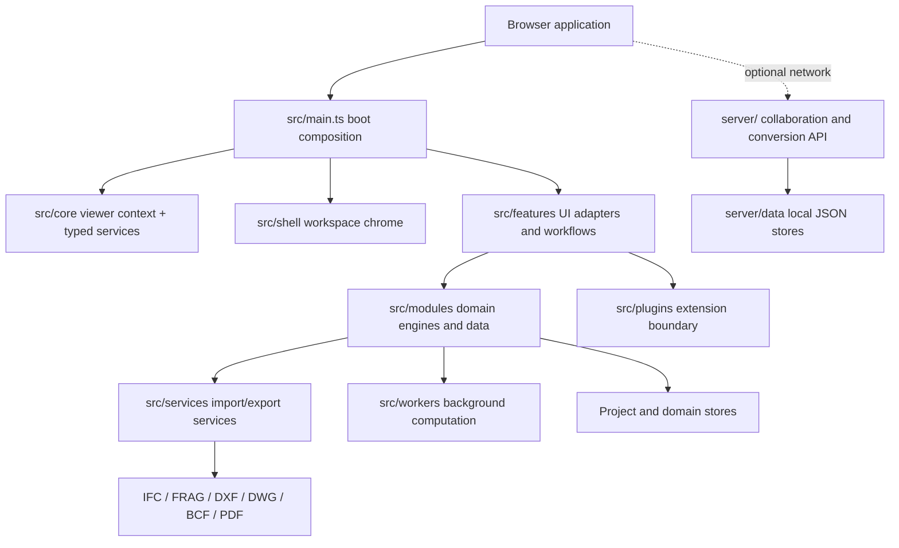
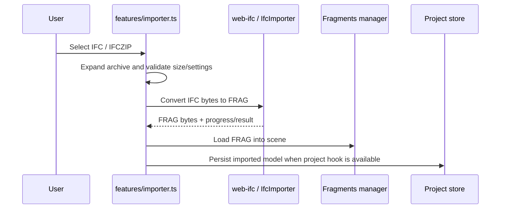

# Engineering architecture map

> **Source of truth for this map:** the top-level directories currently present in `src/modules/`. The directory inventory is checked against the repository tree by `test:architecture-map` in CI. This document describes the current code boundaries; it does not certify every capability as production-ready.

## System at a glance

OpenBIMStudio is a browser-based TypeScript application. Its code is organized around a viewer/runtime context, a large startup composition root, user-facing feature adapters, domain-oriented modules, file/interop services, workers, and an optional local collaboration/conversion server. The separation is a direction and convention, not a claim that every module is already isolated: several older features still combine UI, state and domain operations.



## Runtime and boot lifecycle

1. `src/main.ts` is the composition root. It imports feature setup functions and performs named asynchronous boot steps.
2. Global error handlers are installed before feature boot. Secure storage and the viewer are initialized first. If the viewer is unavailable, startup aborts rather than initializing tools against a missing world.
3. The shared viewer context is defined in `src/core/context.ts` and populated by `src/core/setup.ts`. It exposes the components/world, fragments manager, highlighter, clipper, viewport hosts, camera/scene helpers and a legacy feature bag.
4. The input router, diagnostics and core interaction systems are initialized before most feature panels and tools.
5. Domain and UI setup functions are then registered in sequence: authoring, projects, families, issues/BCF, cost/CDE, standards/IDS, model tree, schedules, file interop, drawing, navigation, MEP, AI, automation, sheets and workspace components.
6. The shell, shortcuts and workspace chrome are initialized; the plugin system boots last so its services are available.

Most named steps are wrapped by `step(name, fn)`: an individual failure is logged and the viewer continues without that feature. Viewer initialization failure is a hard stop. Therefore, a successful page load alone does not prove that every booted feature initialized; use diagnostics and the feature-maturity registry.

## Main code boundaries

| Boundary | Primary paths | Responsibility and constraints |
|---|---|---|
| Composition root | `src/main.ts` | Orders application initialization. Avoid adding domain logic here; add a setup boundary and register it deliberately. |
| Runtime/core | `src/core/` | Viewer context, typed services, input routing, errors, diagnostics, units, locale, secure storage and common infrastructure. Keep domain decisions out of core. |
| Shell/workspace | `src/shell/`, `src/modules/workspace-layout.ts` | Ribbon, file menu, home screen, status bar, viewport toolbar and workspace layout. Shell code should call feature/domain contracts rather than reimplement them. |
| UI features | `src/features/` | User-facing panels, interaction controllers and adapters. A UI handler should validate input and delegate domain work. |
| Domain modules | `src/modules/` | BIM, geometry, drawing, MEP, coordination, data, project and engineering rules. Prefer deterministic logic with explicit inputs/outputs so it can be tested without a browser. Not every legacy module is fully pure today. |
| Services | `src/services/` | Cross-cutting conversion/interop services such as BIM round-trip/import helpers. Inspect the implementation before claiming an external workflow is supported. |
| Workers | `src/workers/`, worker entrypoints | Background compute and server worker code. Heavy geometry/parser work should avoid blocking the UI thread where practical. |
| Plugins | `src/plugins/` | Extension API, types, loader and boot boundary. Plugin operations must use supported host services and report unsupported actions honestly. |
| Local server | `server/` | Optional collaboration/project-room API, authentication/security middleware, SSE and conversion endpoints. It is not required for the browser's local-first core. |

## Domain module inventory

The following inventory is generated from a repository inspection of `src/modules/` at the commit that introduced this document. It includes every top-level module directory exactly once. The CI test checks directory coverage, not the prose descriptions or runtime quality of each module.

### Authoring, spatial modeling and parametric design

Authored elements, geometry, constraints, hosted features, levels, site placement and parametric regeneration.

`adaptive` · `analytical-model` · `architecture-depth` · `area-plans` · `building-pad` · `constraints` · `curtain-wall` · `curtainWall` · `dependency-graph` · `dependent-views` · `design-options` · `detail-components` · `detail-patterns` · `detailing` · `filled-regions` · `geometry` · `grid-bubbles` · `groups` · `hosting` · `in-place-mass` · `joins-cleanup` · `justification` · `levels` · `modify` · `model-curves` · `model-groups` · `parametric` · `parametric-constraints` · `parametric-regen` · `parameter-engine` · `phases` · `plan-region` · `project-base-point` · `property-line` · `railings` · `ramps` · `ref-planes` · `roofs` · `rooms` · `stairs` · `toposurface` · `trusses` · `wall-sweeps` · `work-planes` · `transaction`

### MEP, fabrication and structural engineering

Discipline engineering calculations, fabrication objects, reinforcement and structural connection logic.

`fabrication-parts` · `mep` · `rebar` · `structural-connections` · `structural-loads-ui`

### BIM identity, native objects and data definition

Native-model validation and twin reconstruction, families, object identity, material/property definitions and classification.

`bim-gaps` · `families` · `materials` · `material-assignment` · `native-bim` · `native-twin` · `object-hierarchy` · `properties-panel` · `shared-params` · `type-catalog`

### Coordination, federation, collaboration and compliance

Multi-model coordination, issues, standards, model checking, live collaboration and model-to-model relationships.

`bcf` · `cde` · `clash` · `collaboration` · `copy-monitor` · `federation` · `issues` · `model-checker` · `references` · `relationships` · `standards` · `validation`

### drawing, drawing production and file exchange

drawing editing/linking, drawings, parsers, export formats and point-cloud underlays.

`cad` · `cad-link` · `cad-viewer` · `drawings` · `dwg-linking` · `export` · `pdf-review` · `pdf-underlay` · `gis` · `point-cloud` · `rvt` · `solids`

### Project delivery, cost, scheduling and automation

Project stores, automation rules, quantity/cost, schedules, sheets, revisions, worksets and 4D timelines.

`automation` · `cost` · `projects` · `revisions` · `schedule-4d` · `schedules` · `sheets` · `timeline` · `worksets`

### Application navigation, views and authoring support

Navigation, view definitions, snapping/selection, dimensional annotations, model browser, performance and extensibility.

`auto-dimensions` · `dimension-chains` · `keynotes` · `line-weights` · `lod-performance` · `matchline` · `model-tree` · `navigation` · `nl-query` · `north` · `plugin-marketplace` · `scope-box` · `selection` · `shortcuts` · `snapping` · `solid-kernel` · `streaming` · `sun-settings` · `view-filters` · `view-templates` · `views` · `visibility`

### Site, environmental and generative analysis

Site components/topography plus daylight, energy and generative-design analysis.

`daylighting` · `energy-analysis` · `generative-design` · `site-components` · `site-topo`


<!-- module-map:start -->
```json
[
  {
    "name": "Authoring, spatial modeling and parametric design",
    "purpose": "Authored elements, geometry, constraints, hosted features, levels, site placement and parametric regeneration.",
    "directories": [
      "adaptive",
      "analytical-model",
      "architecture-depth",
      "area-plans",
      "building-pad",
      "constraints",
      "curtain-wall",
      "curtainWall",
      "dependency-graph",
      "dependent-views",
      "design-options",
      "detail-components",
      "detail-patterns",
      "detailing",
      "filled-regions",
      "floors",
      "geometry",
      "grid-bubbles",
      "groups",
      "hosting",
      "hosts",
      "in-place-mass",
      "joins-cleanup",
      "justification",
      "levels",
      "model-curves",
      "model-groups",
      "modify",
      "parameter-engine",
      "parametric",
      "parametric-constraints",
      "parametric-regen",
      "phases",
      "plan",
      "plan-region",
      "project-base-point",
      "property-line",
      "railings",
      "ramps",
      "ref-planes",
      "roofs",
      "rooms",
      "stairs",
      "toposurface",
      "transaction",
      "trusses",
      "wall-join",
      "wall-sweeps",
      "work-planes"
    ]
  },
  {
    "name": "MEP, fabrication and structural engineering",
    "purpose": "Discipline engineering calculations, fabrication objects, reinforcement and structural connection logic.",
    "directories": [
      "fabrication-parts",
      "mep",
      "rebar",
      "structural-connections",
      "structural-loads-ui"
    ]
  },
  {
    "name": "BIM identity, native objects and data definition",
    "purpose": "Native-model validation and twin reconstruction, families, object identity, material/property definitions and classification.",
    "directories": [
      "bim-gaps",
      "families",
      "material-assignment",
      "materials",
      "native-bim",
      "native-twin",
      "object-hierarchy",
      "properties-panel",
      "shared-params",
      "type-catalog"
    ]
  },
  {
    "name": "Coordination, federation, collaboration and compliance",
    "purpose": "Multi-model coordination, issues, standards, model checking, live collaboration and model-to-model relationships.",
    "directories": [
      "bcf",
      "cde",
      "clash",
      "collaboration",
      "copy-monitor",
      "federation",
      "issues",
      "model-checker",
      "references",
      "relationships",
      "standards",
      "validation"
    ]
  },
  {
    "name": "CAD, drawing production and file exchange",
    "purpose": "CAD editing/linking, drawings, parsers, export formats and point-cloud underlays.",
    "directories": [
      "cad",
      "cad-link",
      "cad-viewer",
      "drawings",
      "dwg-linking",
      "export",
      "gis",
      "pdf-review",
      "pdf-underlay",
      "point-cloud",
      "rvt",
      "solids"
    ]
  },
  {
    "name": "Project delivery, cost, scheduling and automation",
    "purpose": "Project stores, automation rules, quantity/cost, schedules, sheets, revisions, worksets and 4D timelines.",
    "directories": [
      "automation",
      "cost",
      "projects",
      "revisions",
      "schedule-4d",
      "schedules",
      "sheets",
      "timeline",
      "worksets"
    ]
  },
  {
    "name": "Application navigation, views and authoring support",
    "purpose": "Navigation, view definitions, snapping/selection, dimensional annotations, model browser, performance and extensibility.",
    "directories": [
      "auto-dimensions",
      "dimension-chains",
      "keynotes",
      "line-weights",
      "lod-performance",
      "matchline",
      "model-tree",
      "navigation",
      "nl-query",
      "north",
      "plugin-marketplace",
      "scope-box",
      "selection",
      "shortcuts",
      "snapping",
      "solid-kernel",
      "streaming",
      "sun-settings",
      "view-filters",
      "view-templates",
      "views",
      "visibility"
    ]
  },
  {
    "name": "Site, environmental and generative analysis",
    "purpose": "Site components/topography plus daylight, energy and generative-design analysis.",
    "directories": [
      "daylighting",
      "energy-analysis",
      "generative-design",
      "site-components",
      "site-topo"
    ]
  }
]
```
<!-- module-map:end -->

## Key data and engineering flows

### IFC and fragment model loading



The importer also supports loading existing `.frag` files directly. IFC-to-FRAG conversion is browser/WASM based and has configured size safeguards; large-file behavior is constrained by browser memory. Do not describe the import path as a full lossless IFC round-trip without a specific export/re-import comparison proving that claim.

### Native authored elements and transactions

The authoring UI in `src/features/authoring.ts` delegates creation and parameter changes to the native authoring/model code. The typed service contract in `src/core/services.ts` exposes selected application services. Project persistence and history are separate concerns: a geometry edit is not complete merely because a mesh moved on screen. Tests should cover parameter validation, regenerated geometry, relationships/connectors where applicable, undo/redo, save/reload and exported data.

### Federation and coordination

`src/modules/federation/` owns federation entries and model presentation metadata; it reacts to fragment model add/delete events and persists presentation changes through the project dirty-state path. Clash and model-checking code is separate from federation display. Treat alignment transforms, source coordinates, element identity and discipline metadata as engineering data—not just viewport styling.

### MEP engineering

MEP domain code lives under `src/modules/mep/` and includes connector, connectivity, routing, fitting, sizing, pressure and electrical-related modules. The existence of these modules is not evidence that every system is automatically routed or validated. A production MEP workflow must prove compatible connectors, a connected graph, valid fittings, lifecycle updates after edit/delete, domain calculations and persistence with explicit tests.

### Collaboration and project persistence

The browser has project-scoped stores and `.obsproj` file import/export under `src/modules/projects/`. The optional `server/` exposes project/room APIs and server-sent event endpoints; the collaboration client and worksharing modules live under `src/modules/collaboration/`. Do not infer multi-user transactional safety from the presence of a WebSocket/Yjs dependency or a worksharing class: verify the actual configured transport, conflict policy, authorization and persistence path before claiming deployment-grade collaboration.

### Export and interoperability

Export code is grouped under `src/modules/export/` and drawing-format code under `src/modules/drawings/`. IFC native-twin export, BCF, COBie, FRAG, GLTF and PDF/sheet exporters have distinct scope. The compatibility matrix and feature maturity registry are the authoritative user-facing statements of supported formats and limitations. Do not call an IFC writer a lossless exporter without fixture-based property, relationship, placement, unit and geometry verification.

The APS integration is explicitly experimental in `src/features/feature-maturity.ts`. In particular, `src/services/rfaImport.ts` and `src/services/bimRoundTrip.ts` describe themselves as minimal stubs: the APS job-completion polling and reliable output download/ingestion steps are incomplete or placeholders. Do not present RFA import or an IFC↔RVT round-trip as a delivered production workflow until those steps are implemented and verified with real APS jobs and representative files.

## Service contracts and dependency direction

- Use `src/core/services.ts` for typed cross-feature services where a contract exists. Its registry currently mirrors registered objects into `ctx.features` for migration compatibility.
- `ctx` in `src/core/context.ts` is a shared runtime context, not a general-purpose domain service locator. Avoid adding new untyped global bridges.
- Keep dependencies flowing from UI adapters toward domain contracts. Domain modules should not import ribbon/panel code.
- Avoid circular feature-to-feature imports and duplicated domain rules. Promote a shared rule into a domain module with explicit tests.
- Treat event subscriptions, workers, listeners and scene objects as owned resources: provide cleanup/disposal and test repeated setup/reload where relevant.

## Engineering change workflow

1. **Specify:** describe user problem, in-scope behavior, non-goals, units/coordinate assumptions, acceptance criteria and failure cases before implementation.
2. **Trace:** inspect the current owner module, call sites, state lifecycle, persistence and downstream consumers. Reuse the existing engine; do not add a parallel implementation by default.
3. **Test first:** add a failing regression test for a reproduced defect. For new behavior, define deterministic domain tests and realistic fixtures before UI wiring.
4. **Implement narrowly:** one logical change per branch/PR. Keep UI, domain logic, persistence and format adapters at their existing boundaries.
5. **Verify:** run typecheck, focused tests, the full CI batch for broad changes, native BIM validation, golden IFC corpus checks and production build as applicable. Browser-level acceptance tests are required for important user interactions; unit tests alone cannot prove viewport behavior.
6. **Review:** inspect the complete diff, failure paths, units, coordinate transforms, resource disposal, security and honest feature maturity. Do not suppress a failure by raising a baseline unless the change is independently justified and the remaining debt is tracked.
7. **Release:** merge only through protected-branch rules after required checks and independent review. Verify staging/production behavior and record known limitations.

## Current structural debt and explicit limitations

- The source contains 116 top-level directories under `src/modules/`; this is a broad, historically grown domain surface, not proof of 116 independently bounded packages.
- Several legacy registration modules still expose `window.__obs*` globals; `src/core/services.ts` and the service migration are the intended direction. The current UI-honesty test uses a non-increasing count as a ratchet, so the count itself remains debt.
- `src/main.ts` is a large composition root with many sequential setup steps. The per-step error containment improves resilience but can leave a feature unavailable while the rest of the viewer continues; boot diagnostics must remain visible and actionable.
- Browser-level tests are materially fewer than logic-level tests. Important editing, IFC, drawing and MEP workflows need end-to-end tests against the production build and representative models.
- The existing IFC golden-roundtrip workflow notes that its export leg is currently a second independent parse because a general web-ifc exporter is not available in that harness. Treat its green result as parser/corpus regression evidence, not proof of a complete IFC import-export round-trip.
- Some collaboration and worksharing components are local/client-side abstractions; production multi-user guarantees require end-to-end server, authorization, concurrency and recovery evidence.
- The module map is intentionally a directory inventory, not an architecture dependency graph. Add dependency/layer checks only after a reviewed boundary policy exists; do not invent a rule that the current code does not satisfy.

## References

- [Short architecture overview](../ARCHITECTURE.md)
- [Developer guide](../../documentation/DEVELOPER_GUIDE.md)
- [AI workflow and capability boundaries](../AI_AGENT_WORKFLOWS.md)
- [Compatibility matrix](../COMPATIBILITY.md)
- [Feature maturity registry](../../src/features/feature-maturity.ts)
- [CI unit-test runner](../../scripts/ci-unit-tests.mjs)
